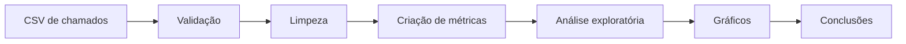

# Análise de Chamados de TI
Para ter uma experiência limpa com analise de dados, a melhor maneira para poder aprender como vamos trabalhar com filtros, parâmetros e registros.
Projeto inicial de análise de dados voltado para chamados de suporte técnico. O objetivo é transformar registros operacionais em indicadores úteis para acompanhar demanda, desempenho, cumprimento de SLA e satisfação dos usuários.

> **Status:** MVP inicial funcional — pronto para ser executado, estudado e evoluído.

## Objetivo do projeto

Uma equipe de suporte precisa entender quais problemas aparecem com maior frequência, quanto tempo leva para resolvê-los e onde estão os principais gargalos. Este projeto utiliza um conjunto de dados fictício, porém realista, para responder perguntas como:

- Quantos chamados foram registrados e concluídos?
- Qual é o tempo médio e a mediana de resolução?
- Qual categoria concentra mais ocorrências?
- Quais prioridades apresentam maior tempo de atendimento?
- Qual é o percentual de cumprimento do SLA?


## Competências demonstradas

- definição de perguntas de negócio;
- leitura e inspeção de arquivos CSV;
- limpeza e transformação de dados;
- tratamento de datas e valores ausentes;
- criação de métricas e indicadores;
- agrupamentos e tabelas-resumo com Pandas;
- visualização com Matplotlib e Seaborn;
- interpretação e comunicação de resultados;
- organização de projeto com Git e GitHub.

## Tecnologias
Usadas:

- Python 3.10+
- Pandas
- Matplotlib
- Seaborn

Futuras:

- Jupyter Notebook, na próxima etapa
- Streamlit, na evolução do dashboard

## Estrutura

```text
analise-chamados-ti/
├── data/
│   └── chamados_ti.csv
├── outputs/
│   └── .gitkeep
├── src/
│   └── analise.py
├── .gitignore
├── requirements.txt
└── README.md
```

## Dicionário de dados

| Coluna | Descrição |
|---|---|
| `id_chamado` | Identificador único do chamado |
| `data_abertura` | Data e hora de abertura |
| `data_fechamento` | Data e hora de conclusão |
| `categoria` | Tipo de solicitação |
| `prioridade` | Nível de urgência |
| `setor` | Área que solicitou atendimento |
| `tecnico` | Responsável pelo atendimento |
| `status` | Situação do chamado |
| `sla_horas` | Prazo máximo acordado |
| `satisfacao` | Nota de 1 a 5 dada pelo usuário |

O script calcula automaticamente `tempo_resolucao_horas` e `sla_cumprido`.

## Como executar

### 1. Clone o repositório

```bash
git clone https://github.com/cgsbrun0/analise-chamados-ti.git
cd analise-chamados-ti
```

### 2. Crie um ambiente virtual

No Linux:

```bash
python3 -m venv .venv
source .venv/bin/activate
```

No Windows:

```powershell
python -m venv .venv
.venv\Scripts\activate
```

### 3. Instale as dependências

```bash
pip install -r requirements.txt
```

### 4. Execute a análise

```bash
python src/analise.py
```

Os indicadores aparecerão no terminal. Os gráficos e o resumo por categoria serão salvos em `outputs/`.

## Indicadores do MVP

O código calcula:

1. total de chamados;
2. quantidade de chamados concluídos;
3. tempo médio de resolução;
4. mediana do tempo de resolução;
5. percentual de cumprimento do SLA;
6. satisfação média;
7. volume de chamados por categoria;
8. tempo médio por prioridade;
9. volume por setor;
10. resumo exportado para CSV.

## Fluxo analítico



## Próximos passos do projeto

### Etapa 1 — Entender o MVP

- [ ] Executar o projeto sem alterar o código.
- [ ] Abrir o CSV e identificar cada variável.
- [ ] Ler `src/analise.py` linha por linha.
- [ ] Conferir se os valores do terminal correspondem aos dados.
- [ ] Escrever, com suas próprias palavras, três conclusões no README.

**Aprendizado:** estrutura de uma análise e funcionamento básico do Pandas.

### Etapa 2 — Criar um notebook analítico

- [ ] Criar `notebooks/analise_exploratoria.ipynb`.
- [ ] Separar a análise em células: contexto, importação, inspeção, limpeza, análise e conclusão.
- [ ] Usar `head()`, `info()`, `describe()` e `isna().sum()`.
- [ ] Explicar em Markdown o motivo de cada transformação.
- [ ] Colocar os gráficos dentro do notebook.

**Aprendizado:** análise exploratória e comunicação do raciocínio.

### Etapa 3 — Formular hipóteses

- [ ] Verificar se chamados críticos realmente são resolvidos mais rapidamente.
- [ ] Comparar satisfação entre categorias.
- [ ] Investigar quais setores possuem menor cumprimento de SLA.
- [ ] Comparar média e mediana para identificar valores extremos.
- [ ] Registrar limitações do conjunto de dados.

**Aprendizado:** deixar de apenas gerar gráficos e começar a interpretar evidências.

### Etapa 4 — Adicionar SQL

- [ ] Importar o CSV para SQLite ou PostgreSQL.
- [ ] Criar uma tabela `chamados` com tipos adequados.
- [ ] Reproduzir os KPIs usando `SELECT`, `WHERE`, `GROUP BY` e `CASE`.
- [ ] Salvar as consultas em `sql/consultas.sql`.
- [ ] Comparar os resultados SQL com os resultados do Pandas.

**Aprendizado:** consultas usadas no cotidiano de um analista de dados.

### Etapa 5 — Construir um dashboard

- [ ] Criar um dashboard com Streamlit.
- [ ] Adicionar cartões de total, tempo médio, SLA e satisfação.
- [ ] Criar filtros por data, prioridade, categoria e setor.
- [ ] Adicionar gráficos interativos com Plotly.
- [ ] Publicar o dashboard no Streamlit Community Cloud.

**Aprendizado:** transformar análises em uma ferramenta utilizável.

### Etapa 6 — Melhorar a qualidade do projeto

- [ ] Criar testes para as principais transformações.
- [ ] Usar funções menores e documentadas.
- [ ] Criar um arquivo de dados maior e com problemas propositais.
- [ ] Incluir screenshots dos gráficos no README.

**Aprendizado:** qualidade, reprodutibilidade e manutenção.

## Trilha pessoal para se desenvolver como analista

Use este projeto como eixo para estudar na seguinte ordem:

| Fase | Conhecimento | Aplicação neste projeto |
|---|---|---|
| 1 | Excel/Google Sheets | Conferir, filtrar e resumir o CSV |
| 2 | Python básico | Variáveis, funções, condições e arquivos |
| 3 | Pandas | Limpeza, transformação e agrupamento |
| 4 | Estatística descritiva | Média, mediana, dispersão e outliers |
| 5 | Visualização | Escolher gráficos e evitar interpretações enganosas |
| 6 | SQL | Consultar e agregar os chamados em banco |
| 7 | Storytelling | Explicar problema, evidência e recomendação |
| 8 | Dashboard | Permitir exploração dos indicadores |
| 9 | Git/GitHub | Registrar versões e apresentar o trabalho |

### Regra de evolução

Para cada gráfico, responda:

1. Qual pergunta ele responde?
2. O que os dados mostram?
3. Por que isso importa para o negócio?
4. Qual ação poderia ser tomada?
5. Quais limitações impedem uma conclusão mais forte?

Essa sequência é o que transforma um exercício de programação em um projeto de análise de dados.

## Ideias de conclusões para investigar

Não copie estas frases como resultados definitivos. Execute a análise e confirme:

- categorias com grande volume podem justificar materiais de autoatendimento;
- baixo cumprimento de SLA pode indicar capacidade insuficiente ou classificação inadequada;
- diferenças entre média e mediana podem revelar chamados muito demorados;
- satisfação baixa pode estar associada ao tempo de resolução ou ao tipo de problema;
- concentração de solicitações em um setor pode indicar necessidade de treinamento ou melhoria de infraestrutura.

## Melhorias futuras

- substituir os dados fictícios por um conjunto público ou anonimizado;
- criar análise mensal e indicadores de tendência;
- medir reincidência de problemas;
- avaliar desempenho sem transformar métricas em julgamento isolado de pessoas;
- criar previsão de volume de chamados;
- integrar o projeto ao HelpDesk Lite;
- automatizar atualização dos dados.

## Como apresentar no portfólio

Descrição sugerida para o GitHub:

> Análise de chamados de suporte de TI com Python e Pandas, incluindo limpeza de dados, indicadores de SLA, visualizações e recomendações de negócio.

Tópicos sugeridos:

`data-analysis` `python` `pandas` `matplotlib` `seaborn` `helpdesk` `sla` `portfolio`

## Autor

**Caio Guilherme dos Santos Bruno**  
Em transição e desenvolvimento profissional para a área de Análise de Dados.

## Aviso sobre os dados

Os dados deste repositório são fictícios e foram criados exclusivamente para estudo. Não representam pessoas, empresas ou atendimentos reais.


## Resultados reais

Para fins comparativos, foi adicionado uma sessão para determinar resultados reais a partir do uso do sistema. Assim, pode executar o script e apresentar indicadores e prévias reais dos gráficos gerados para que possamos mostrar nossos dados de maneira mais visual.
